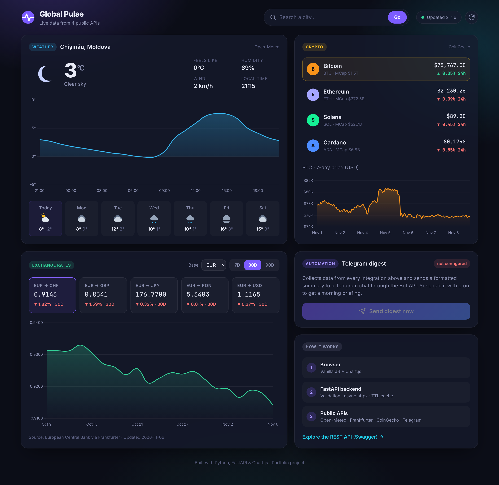
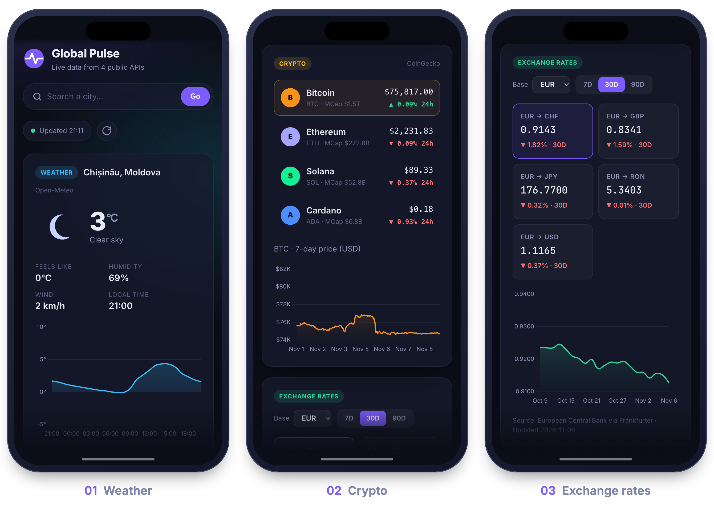

# Global Pulse — API Integration Dashboard

A live dashboard that **aggregates data from four public APIs** behind a clean, validated
**FastAPI** backend and presents it in a responsive web UI. It also **automates delivery**
by pushing a formatted digest to **Telegram**.

## Screenshots

**Desktop**



**Mobile**: the layout adapts to phone screens

<p align="center">
  
</p>

## What it does

| Integration | API | What you get |
|---|---|---|
| 🌦 Weather | [Open-Meteo](https://open-meteo.com/) (geocoding + forecast) | Current conditions, next-24h temperature chart, 7-day forecast for any city |
| 💱 Exchange rates | [Frankfurter](https://frankfurter.dev/) (European Central Bank data) | Latest rates for any base currency, % change and a 7/30/90-day history chart |
| ₿ Crypto | [CoinGecko](https://www.coingecko.com/en/api) | Prices, 24h change, market cap and a 7-day price chart |
| ✈️ Notifications | [Telegram Bot API](https://core.telegram.org/bots/api) | One-click (or scheduled) digest with all of the above sent to a chat |

## Highlights

- **Clean REST API** with automatic Swagger docs at `/docs`
- **Async I/O** with one shared `httpx.AsyncClient` connection pool; the digest fetches all sources in parallel with `asyncio.gather`
- **Input validation** (FastAPI + Pydantic) and a clear JSON error format
- **Error handling**: timeouts, HTTP errors and rate limits (HTTP 429) become friendly messages; unknown cities return 404
- **TTL cache** so the dashboard stays fast and respects third-party rate limits
- **Security**: secrets come from `.env`, the Telegram token never appears in logs or responses, and user content is HTML-escaped
- **Tests**: 11 pytest tests, with every external API mocked through `httpx.MockTransport` (they run offline in under a second)
- **Responsive UI** built with vanilla JS and Chart.js: dark glassmorphism design, loading skeletons, toasts and auto-refresh every 5 minutes; respects `prefers-reduced-motion`

## Architecture

```
Browser (HTML/CSS/JS + Chart.js)
        │  fetch /api/*
        ▼
FastAPI backend ── validation ── TTL cache
        │  async httpx
        ▼
Open-Meteo · Frankfurter · CoinGecko · Telegram
```

```
app/
├── main.py            # FastAPI app, routes, error handlers
├── config.py          # settings from environment / .env
├── cache.py           # in-memory TTL cache
└── services/
    ├── http.py        # shared GET helper + error types
    ├── weather.py     # Open-Meteo integration
    ├── currency.py    # Frankfurter integration
    ├── crypto.py      # CoinGecko integration
    └── telegram.py    # digest builder + Bot API sender
static/                # frontend (index.html, css/, js/)
tests/                 # pytest suite with mocked HTTP
```

## Quick start

```bash
python3 -m venv .venv
source .venv/bin/activate
pip install -r requirements-dev.txt
cp .env.example .env          # optional: add Telegram credentials

uvicorn app.main:app --reload
```

Open **http://localhost:8000** for the dashboard or **http://localhost:8000/docs** for the API.

### Enable Telegram (optional)

1. Create a bot with [@BotFather](https://t.me/BotFather) and copy the token.
2. Send any message to your bot, then open `https://api.telegram.org/bot<TOKEN>/getUpdates` and copy `chat.id`.
3. Put both values in `.env` (`TELEGRAM_BOT_TOKEN` and `TELEGRAM_CHAT_ID`), then restart the server.

To get a daily briefing automatically, schedule it with cron:

```bash
0 8 * * * curl -s -X POST localhost:8000/api/notify -H "Content-Type: application/json" -d '{"city":"London"}'
```

## API reference

| Method | Endpoint | Description |
|---|---|---|
| GET | `/api/health` | Service status and whether Telegram is configured |
| GET | `/api/weather?city=Paris` | Current weather, 24h hourly forecast and 7-day forecast |
| GET | `/api/currencies` | Supported currency codes |
| GET | `/api/rates?base=EUR&symbols=USD,GBP&days=30` | Latest rates, % change and history |
| GET | `/api/crypto?ids=bitcoin,ethereum&vs=usd` | Coin prices, 24h change and market cap |
| GET | `/api/crypto/{coin}/history?days=7` | Price history for one coin |
| POST | `/api/notify` | Build the digest and send it to Telegram |

## Tests

```bash
pytest        # 11 tests, fully offline
ruff check .  # lint
```

## Tech stack

Python 3.11+ · FastAPI · httpx (async) · Pydantic · pytest · Ruff · HTML/CSS · JavaScript · Chart.js
